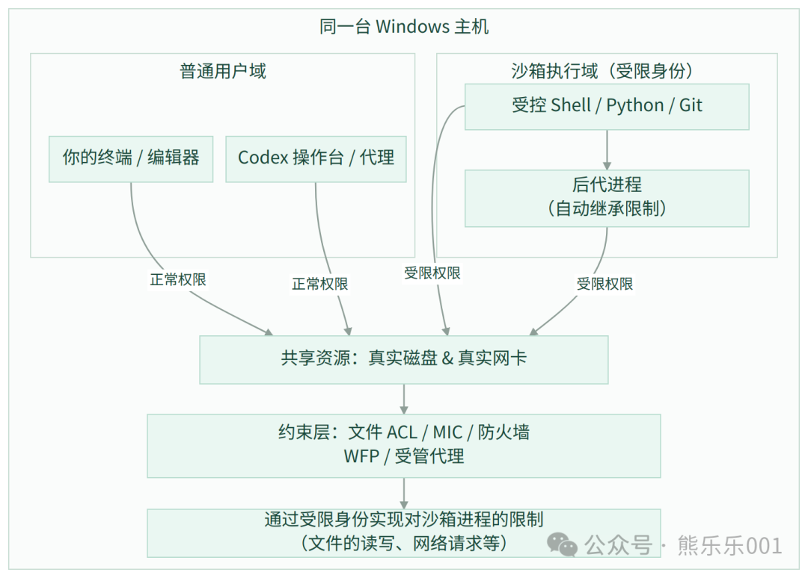
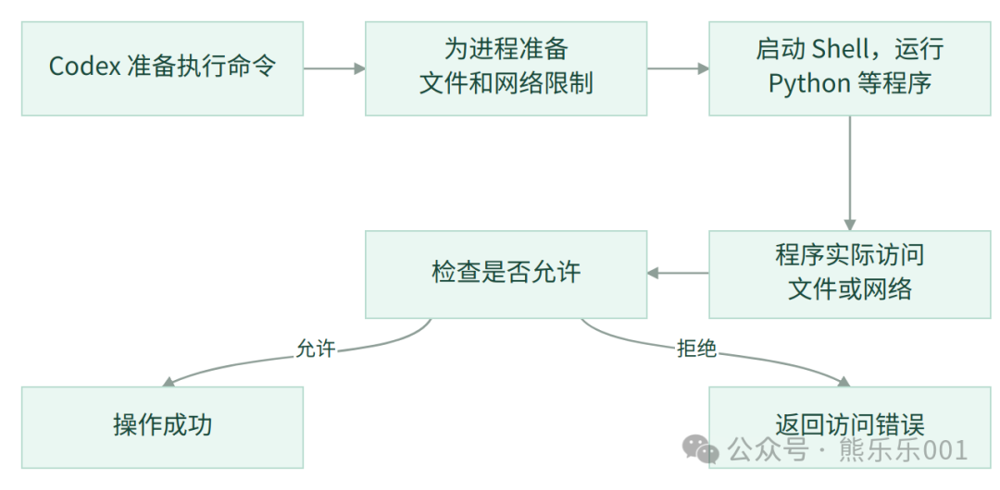
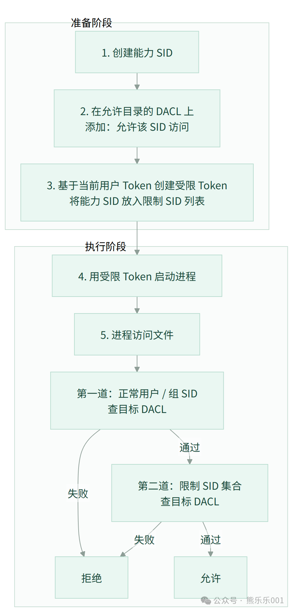
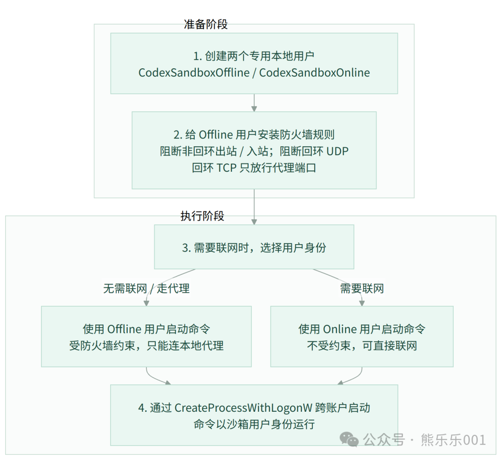
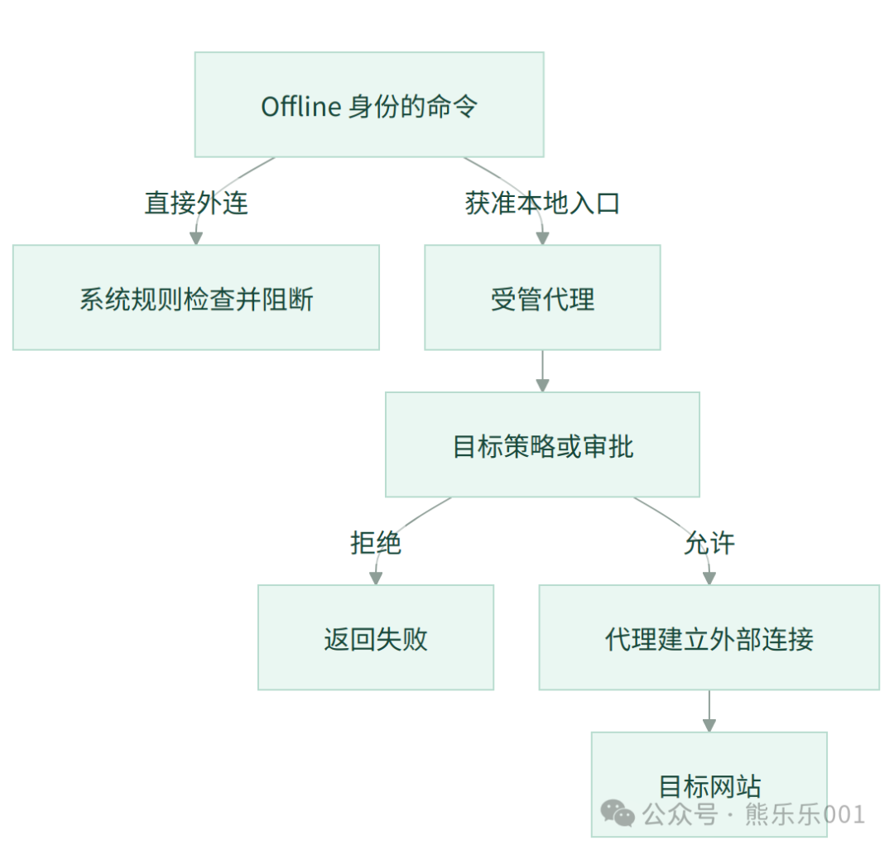

沙箱这个概念早有耳闻，在当前这个Agent时代，对沙箱的要求又提升了一层，Agent在我们的电脑工作，需要访问电脑上的文件，使用我们已经安装的工具和配置的环境，比如Python、uv、npm等等，并且要能够执行相关命令，才更好能帮我们干活，但是，又不能让它随意访问敏感信息，执行恶意操作产生破坏。这就导致了沙箱的治理难度高出了很多，治理的边界也变得没那么容易确定。

这几天看了Codex在Windows上面的沙箱实现，让我惊叹于Codex团队的探索和实践精神，由于Windows上面没有现成的类似linux上的Seccomp 工具，实现起来还是比较困难的，Codex团队在Windows上面硬生生的开辟出了一条特别的沙箱实现方案，中间经过了几次大的调整才逐步收敛到目前的方案，最大程度确保Agent看到的和可执行的工具和我们一致，并且把Agent限制在尽可能安全的范围内，话不多说，开始拆解。

### 1、误区

提到 Agent 沙箱，我首先想到是临时虚拟机或者容器：文件读写、程序执行在独立环境中完成，结束后销毁。这导致我先入为主的去理解Codex的沙箱设计，初期根本无法理解，走了很多弯路。

实际上Codex是直接利用Windows系统层面的能力对进程进行限制和约束，PowerShell、Python 和 Git 仍然是本机程序，项目文件仍然是磁盘上的真实文件。变化的是进程的执行身份、令牌及适用的访问规则。



### 2、一条命令怎么进入沙箱

Codex 执行一个Python 脚本：



这就是基本的流程，最为核心的就是第二步：为进程准备文件和网络限制，这一步的目的是限制进程能够访问哪些目录，是否有写、修改这些控制权限，我们不希望这个进程访问限定范围之外的内容，比如：读取.ssh秘钥，.env文件这些敏感信息，或者访问外部网络，读取和下载无法确定的东西。

沙箱最重要的两块内容就是文件的访问和操作权限，以及外部网络的访问权限，Codex在这两块的实现有所不同（分别是unelevated和elevated两种方式），下面分开讲解

### 3、文件权限：<strong>用 SID + DACL + 受限 Token 实现硬约束</strong>

大家在使用Codex或者其他Harness框架应该都会发现，Agent可以在当前工作区读写，当需要修改当前项目之外的内容的时候就会向我们发出请求，我们允许后Agent才可以进行修改，我们不能指望AI会乖乖守规矩，我们没允许它，它就不去碰外部文件，我们必须要在底层实现硬性约束，就算它去偷偷修改，也没法成功。

我们先朴素的思考一下这个怎么实现，就是有一个身份，这个身份只允许访问当前工作区目录和一些必要的外部目录，除此之外的文件访问，直接被操作系统拒绝。整体思路就是如此。

Windows 底层对对象访问控制的具体实现，涉及三个核心概念：

| <strong>概念</strong> | <strong>作用位置</strong> | <strong>作用</strong> |
| --- | --- | --- |
| <strong>SID</strong> | 身份标识 | 可以粗浅理解为用户 ID，标识一个安全主体 |
| <strong>DACL</strong> | 文件 、目录等 | 这个对象的访问规则，记录哪些 SID 允许或拒绝哪些操作 |
| <strong>Token</strong> | 进程 | 进程的通行证，记录用户身份、组身份、限制身份、特权等 |

这几个东西具体长下面这样：

- <strong>SID（Security Identifier 安全标识符）：</strong>S-1-5-21-975480362-4135443421-1641059036-1006

- <strong>DACL（Discretionary Access Control List 自主访问控制列表）:</strong>

```text
D:(A;OICI;FA;;;SY)(A;OICI;FR;;;S-1-5-21-111-222-333-1001)
拆解：
(A;OICI;FR;;;S-1-5-21-111-222-333-1001)
 │  │   │                 │
 │  │   │                 └─ 身份 SID
 │  │   └─ FR：文件通用读取权限
 │  └─ OI、CI：文件与子目录继承
 └─ A：Allow，允许
```

- <strong>Token 是内核对象：</strong>

```text
TokenId：         本次令牌对象标识
UserSid：         沙箱账户 SID
IntegrityLevel：  Medium
RestrictedSids：  [SID-1,其他需要的 SID, 登录 SID, Everyone]
Privileges：      持有的系统特权及状态
DefaultDacl：     新对象采用默认安全信息时使用的规则
```

图解：



<strong>关键：不是让 AI 主动遵守规则，而是让 Windows 内核在它每次访问文件时强制执行规则，而且这里的规则检查相当的底层，不论是Python程序访问目录还是shell命令，只要向 Windows 请求创建、打开或修改文件，就需要接受权限检查。</strong>

这里有个小细节就是第三步：基于当前用户的Token新建一个受限Token，为什么不直接创建一个新token呢？

因为需要确保约束后的进程保留当前用户的全部基础能力，比如你的Git，Python等等，新的受限进程都可以用，然后通过限制的SID实现控制，它是在原有安全上下文上削弱特殊能力、增加访问条件。

从当前用户的 Token 派生一个受限 Token的效果是：

```text
新 Token 的身份：仍然是你
    ├─ 用户 SID：还是你
    ├─ 组 SID：还是你的组
    ├─ 完整性级别：还是 Medium
    └─ 所以：你原本能读的，它还能读；你原本能用的，它还能用
```

与此同时：

```text
新 Token 的限制：
    ├─ 特权被削减（DISABLE_MAX_PRIVILEGE）
    ├─ 限制 SID 列表加入能力 SID（WRITE_RESTRICTED）
    └─ 写操作时，必须额外通过限制 SID 的 DACL 检查
```

#### <strong>执行前的两道检查</strong>

```text
普通身份检查：
    原账户及其组是否有权执行本次请求？
    涵盖相应的读取、执行、写入等操作。

限制身份检查：
    对写类访问，再检查限制 SID 集合是否取得所需权限。

写、修改访问需要两道都通过。
```

到这里，文件限制的核心关系就基本清楚了：文件<strong>对象上准备访问规则，进程中准备受限身份，访问发生时由 Windows 检查受限身份是否能够访问文件对象。</strong>

### <strong>4、网络权限：用独立用户 + 防火墙 实现内核级隔离</strong>

这里自然会有一个疑问，为什么网络使用新建的独立用户，文件访问使用当前用户？

文件权限的核心是：<strong>目标对象有 DACL，在文件对象的DACL里面限制哪个SID可以干什么，Token 拿 SID 去匹配就可以。但是</strong>网络连接没有对应的 DACL。不能在 TCP 连接上挂一个SID来进行控制。

所以，网络隔离需要换一个更适合Windows系统的方式：

<strong>不是用 Token 里的限制 SID 来匹配，而是创建一个真实的本地用户身份，让防火墙规则直接匹配这个用户的 SID，当以这个新用户身份启动进程进行网络访问时，防火墙就会进行拦截，通过专用账户限制网络出口。</strong>

#### <strong>图解：</strong>

<strong></strong>

#### <strong>代理的作用</strong>

即使使用离线用户，Codex 也不是完全断网。它开放了一个<strong>本地代理端口，</strong>这个端口由 <strong>Codex Harness 主进程（以你当前的用户身份运行）</strong> 启动：



网络访问的设计非常有意思，为什么剥离所有的网络访问，只保留代理的端口呢？GPT给了我一个很好的比喻，把这里想象成一座监狱，把Agent关在里面，只保留一个窗口来和外界交互，然而这个窗口又在我们的掌控之下，它想要访问外界的任何IP或者域名都需要经过Harness代理模块的审查，访问的这个IP有没有记录，没有的话就需要发起审批，审批通过后，才能进行访问，这就完成了对Agent网络请求的完美控制。

### 总结

通过上面的讲解，大概就明白了Codex沙箱的两大核心 - 文件权限和网络权限，一个把Agent的文件权限操作权限牢牢限制住，一个把网络请求把控住，从系统底层避免了Agent做出预期之外的操作，而不是通过提示词的方式让Agent乖乖遵守。

篇幅有限，只呈现了核心的逻辑部分，Codex团队在整个过程经过了 很多尝试，才逐步收敛到了当前的Windows沙箱设计，在没有现成路径的情况下，一步步探索和实践，硬生生的在Windows上面实现了操作系统级别的沙箱。不得不感慨，What a beautiful design.

OpenAI官方博客：https://openai.com/zh-Hans-CN/index/building-codex-windows-sandbox

---

原文发布于微信公众号：[Codex 沙箱核心机制：Agent 安全的最后一道防线](https://mp.weixin.qq.com/s/GbUQJfnk5MR057Ze-GwXcw)
