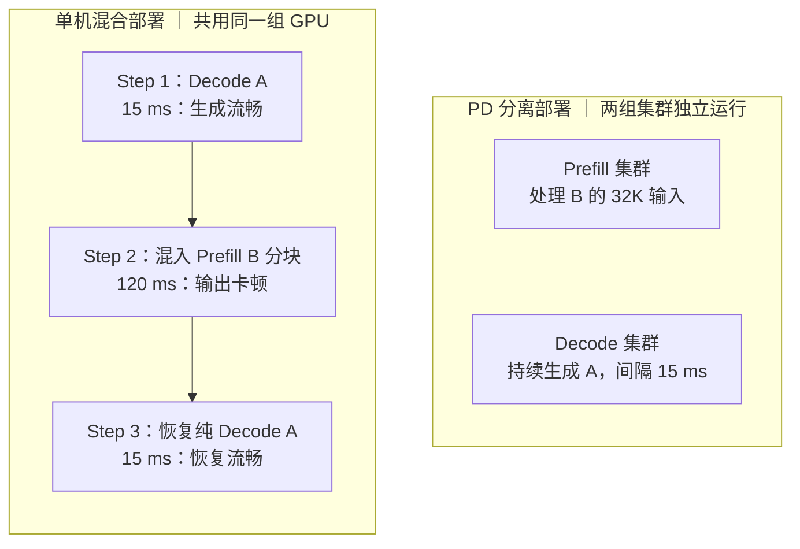
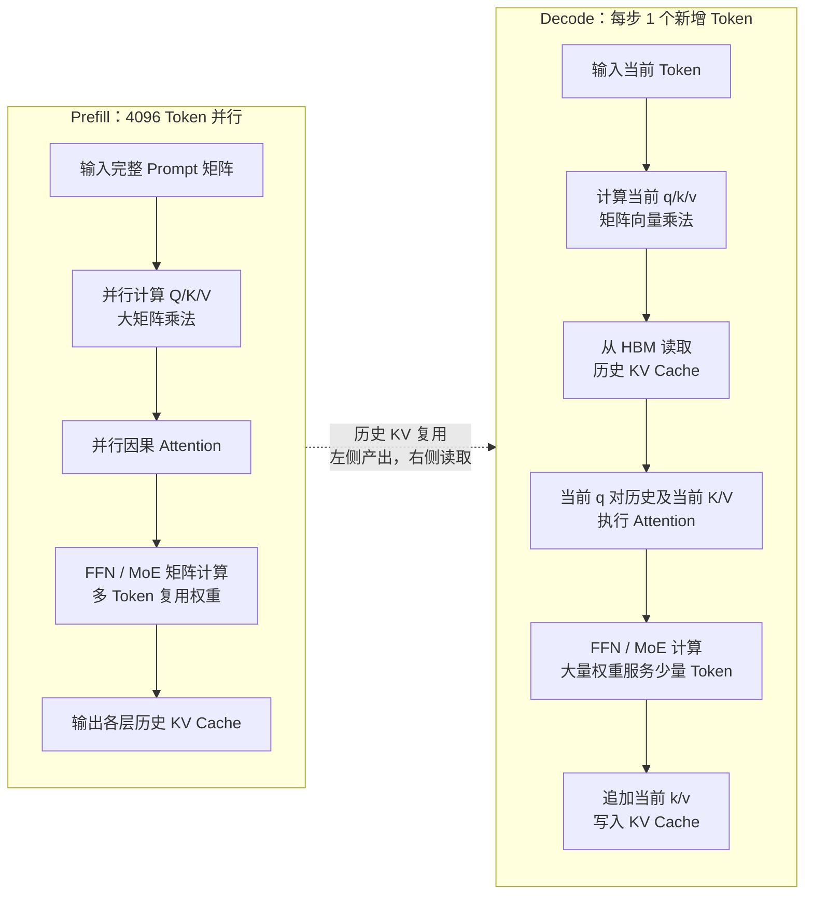
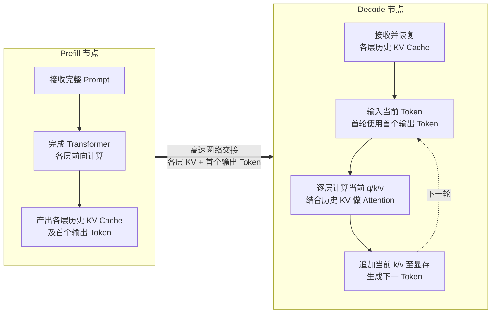
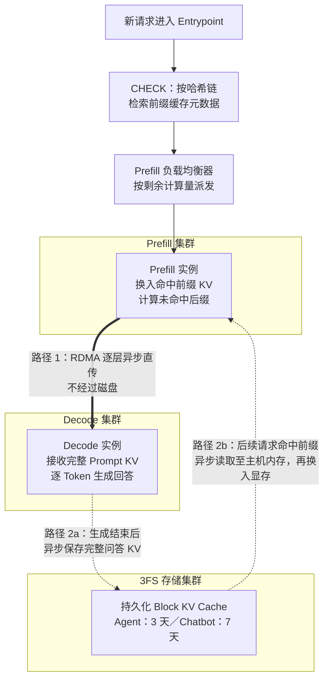
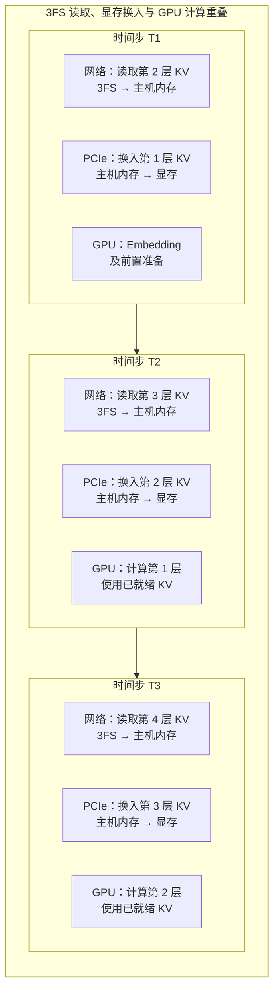
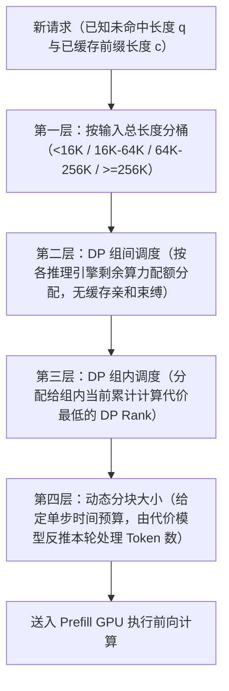
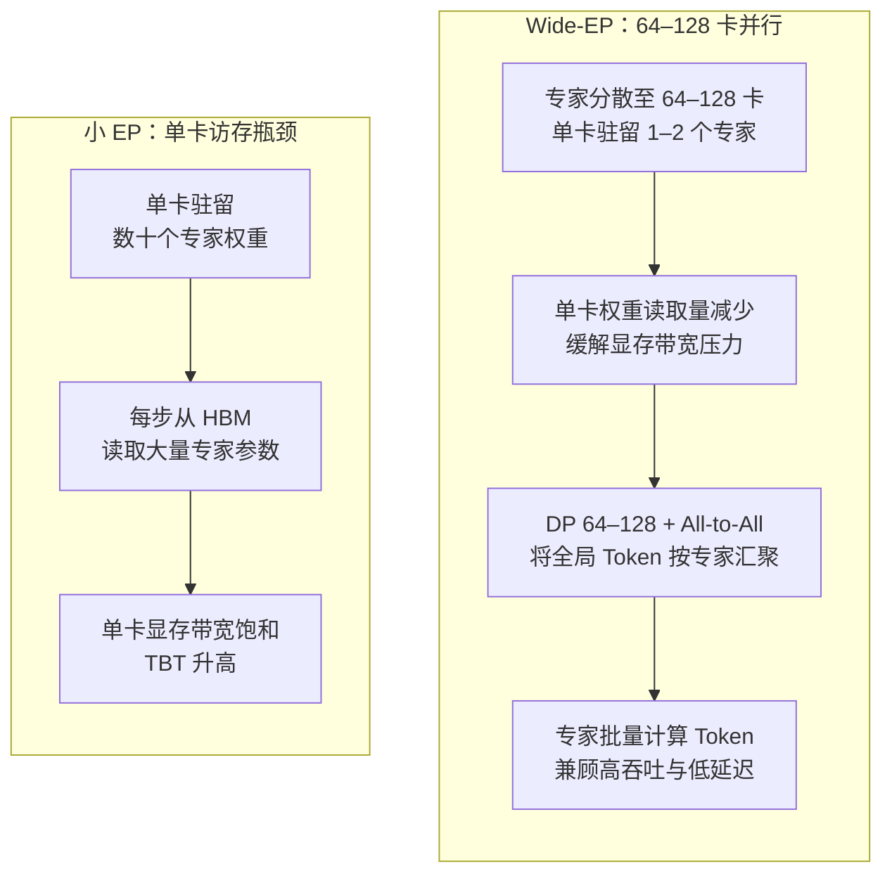

在使用本地部署的大模型时，可能会出现模型原本正在流畅地输出内容，却突然停顿了一下，过了一会儿才继续生成。在单机部署的高并发场景下，这种现象与大模型推理的两个阶段——**Prefill 和 Decode 共享 GPU 资源**有关。

最近，DeepSeek 开源了推理框架 DeepInfer，并介绍了 DeepSeek-V4.1-Flash 生产推理系统的架构，这给了我一个很好的机会了解实际支撑起这么大访问量的在线推理服务到底是怎么做的，因为自己部署过基于 vLLM 和 SGLang 的推理服务，模型的 Token 生成速度、首 Token 延迟和主流厂商的在线服务完全不在一个层级，抛开硬件限制不谈，其实特别想知道这些大模型在线服务厂商究竟是怎么做到的。

PD 分离（Prefill 和 Decode 两阶段拆开，分别部署在不同的机器上面，针对两个阶段不同的计算特点，分别优化资源配置和负载均衡）这个概念早有耳闻，理解起来也并不复杂，但是，里面有很多工程化的问题我不知道具体是怎么解决的，比如：

1. **跨机传输开销**：原本留在单卡显存里的 KV Cache，现在需要跨机器传给 Decode 节点，长文本下几百 MB 甚至上 GB 的数据怎么传才不会把网络打满、拖慢首字延迟？
2. **缓存亲和性与负载均衡的死结**：之前算过的 Prompt 缓存（Prefix Cache）如果留在机器 A，下次相同前缀的请求如果为了负载均衡被路由到了空闲的机器 B，岂不是要从头重算？如果通过共享存储（如 3FS）来解决，从远端存储读取 KV Cache 的过程又该如何设计，才能避免 GPU 停下来傻等 I/O？
3. **异构负载的精准调度**：不同请求的 Prompt 长度不同、前缀缓存命中率也不同，怎么精准预估耗时并做负载均衡？为什么分离之后，Prefill 和 Decode 连底层的 MoE 专家并行（EP）规模都完全不一样？

本文将从单机推理卡顿的物理根源出发，补充必要的 Transformer 推理计算与硬件瓶颈原理，并结合 DeepSeek 官方披露的生产架构，抽丝剥茧地还原一套高性能在线 PD 分离系统是如何解决上述工程难题的。

> **说明**：DeepInfer 目前已开源推理引擎的核心单机能力，而完整的跨机 PD 服务编排、全局 KV Cache 存储管理以及跨副本负载均衡策略，主要提炼自 DeepSeek 官方披露的生产架构设计文档与技术问答。

---

## 一、 单机混合部署的物理瓶颈与 PD 分离的必然性

要理解为什么生产系统必须走向 PD 分离，需要先回到单机混合部署的现场，看看生成卡顿的瞬间，GPU 内部究竟发生了什么。

### 1.1 时间片轮转的局限与单机资源争用

假设一台 GPU 服务器正在同时处理两个请求：

- **请求 A（Decode 阶段）**：已经在持续生成回答，每隔几十毫秒向用户输出一个 Token。
- **请求 B（Prefill 阶段）**：刚刚进入系统，携带了一篇 32K Tokens 的长文档，需要先完成输入文本的预填充计算。

在早期的推理实现中，GPU 必须先把请求 B 的 32K Tokens 全部算完，才能回头继续计算请求 A 的下一个 Token，这会导致请求 A 直接停滞数秒。

为了缓解这一问题，现代推理框架（比如：vLLM,SGLang）引入了 **Continuous Batching（连续批处理）** 和 **Chunked Prefill（分块预填充）** 技术：将请求 B 的 32K 长文本切分成多个小块（Chunk，例如每次切 2K Tokens），然后与请求 A 正在生成的 1 个 Token 拼接在同一个批次（Batch）里，交错送入 GPU 执行。

然而，**在时间片上做切分（Time-slicing），并没有消除底层物理资源的竞争**。只要请求 B 的 Prefill 分块被塞进当前的执行批次，GPU 单步计算的耗时会立刻从原本纯 Decode 的十几个毫秒，拉长到上百毫秒。表现在用户侧，就是请求 A 的输出流出现明显的停顿。

衡量在线推理服务性能有两个核心指标：

- **TTFT（Time To First Token，首 Token 延迟）**：用户发出请求后到首个 Token 返回的时间，反映系统开始响应的速度。
- **TBT（Time Between Tokens，Token 间延迟）**：相邻两个输出 Token 之间的时间间隔，反映模型生成过程是否流畅。

在单机混合部署下，**TTFT 和 TBT 处于直接的资源博弈状态**：若想让新请求更快吐出首字（降低 TTFT），就需要调大单次处理的 Prefill 分块，但这会立刻拉长同批次老请求的单步耗时（劣化 TBT）；若想保住老请求的流畅生成（降低 TBT），就必须把 Prefill 切得极碎并限制准入，这又会导致长文本请求长期排队、首字响应变慢。所以在单机部署中就需要对最大的请求数（**`--max-num-seqs`**）和最大的批处理Token数（**`--max-num-batched-tokens`**）进行限制，来保障正在处理请求的稳定

要彻底解开这一矛盾，只能放弃单卡时间片复用，将两个阶段放到不同的物理集群上独立运行。

---

### 1.2 计算密集型与访存密集型的硬件特征差异

即便不考虑调度层面的冲突，仅从 GPU 底层硬件的工作方式来看，Prefill 和 Decode 也有着完全不同的计算特征。

对于 Decoder-only Transformer 模型（在 MoE 架构中包含专家网络），每一层的前向计算主要由 **Attention（注意力层）** 和 **FFN / MoE（前馈与专家网络）** 组成。虽然两个阶段走的是同一套模型权重，但每次送入 GPU 的数据规模相差悬殊：

**1. Prefill 阶段：多 Token 并行计算，瓶颈在于 GPU 算力**

假设输入 Prompt 包含 $4096$ 个 Token。在 Prefill 阶段，模型可以一次性将这 $4096$ 个 Token 打包成大矩阵送入 GPU：

- 在线性投影层（计算 $Q, K, V$）和 MoE 专家层，输入张量与模型权重相乘构成标准的**大矩阵乘法（GEMM）**。
- GPU 从高带宽显存（HBM）读取一次模型权重到片上缓存（SRAM），就能被这 $4096$ 个 Token 共同复用。
- 这种单位数据搬运能够支撑大量乘加运算的特征，具有很高的**算术强度（Arithmetic Intensity）**。此时显存带宽充足，GPU 的计算核心（Tensor Core）满负荷运转，表现为**计算密集型（Compute-bound）**。

**2. Decode 阶段：单 Token 自回归步进，瓶颈在于显存带宽**

当 Prefill 完成并输出首个生成词后，模型进入自回归的 Decode 阶段。假设前面已处理 $4096$ 个 Token，现在需要根据第 $4096$ 个 Token 预测第 $4097$ 个 Token：

1. 只计算当前这 **1 个新增 Token** 在各层的 $q, k, v$ 向量。
2. 从显存中读取前面 $4096$ 个 Token 保存下来的历史键（Key）和值（Value），即 **KV Cache**。
3. 使用新增 Token 的 $q$，与全部 $4097$ 个位置的 $K, V$ 进行注意力计算，随后经过 MoE 专家网络。
4. 将当前步新产生的 $k, v$ 追加写入 KV Cache，供下一步生成使用。

在 Decode 的每一步中，尽管新增的计算量很小（退化为矩阵-向量乘法 GEMV），但 GPU 依然必须将庞大的模型权重和长达数万 Token 的历史 KV Cache 从 HBM 显存搬运到计算单元。由于批次规模较小，读取一次权重仅能服务极少量的 Token，GPU 绝大部分时间都消耗在数据搬运上，计算核心大量闲置，因此表现为典型的**访存密集型（Memory-bound）**。

两个阶段的核心差异总结如下：

| 对比维度 | Prefill（预填充阶段） | Decode（解码生成阶段） |
| --- | --- | --- |
| **单次处理对象** | 整段输入 Prompt（数百至数万 Tokens） | 当前步新增的单个 Token（× 并发请求数） |
| **核心算子形态** | 大规模矩阵-矩阵乘法（GEMM） | 矩阵-向量乘法（GEMV）与历史 KV 扫描 |
| **算术强度（FLOPs/Byte）** | 高（读取一次权重被大量 Token 分摊） | 低（搬运大量权重与历史 KV，仅计算少量 Token） |
| **硬件物理瓶颈** | **GPU 计算能力（Compute-bound）** | **显存带宽（Memory-bound）** |
| **核心优化目标** | 降低首字延迟（TTFT） | 降低生成间隔（TBT）、提升整体吞吐 |

既然两个阶段受限于完全不同的硬件指标，将它们放入独立的 GPU 资源池中针对性优化，便成为生产系统的必然选择。

---

### 1.3 因果注意力机制与 KV Cache 状态边界

为什么一个连贯的神经网络推理过程，能够从中间拆开并交给两台不同的机器接力完成？这取决于 Transformer 的**因果注意力机制（Causal Attention）**。

在因果注意力中，每个 Token 只能关注自身及排在它前面的 Token，不能关注未来的 Token。当 Prefill 节点完成整段输入 Prompt 的前向计算后，历史 Token 在各层产生的 $K$ 和 $V$ 状态就已经完全确定。后续无论生成多少个新 Token，都不会改变前面已经算好的历史 KV 值。

这意味着，**Decode 节点不需要重新执行输入 Prompt 的前向计算，它唯一需要接管的状态，就是 Prefill 算好的各层历史 KV Cache 以及预测出的首个输出 Token。**

因此，KV Cache 不仅避免了重复计算，还在 Prefill 和 Decode 之间划出了一条清晰的状态交接边界。

> **补充背景：DeepSeek MLA 架构对跨机传输的加持**
>
> 在传统的多头注意力（MHA）或分组查询注意力（GQA）模型中，KV Cache 体积非常庞大，跨机器传输长文本 KV Cache 会带来极高的网络带宽压力。DeepSeek 引入的 **MLA（多头潜在注意力）** 架构，通过低秩联合压缩技术，将每一层的 $K$ 和 $V$ 张量压缩为低维度的潜在向量进行缓存。这一模型结构层面的设计，使 KV Cache 体积大幅缩减，直接减轻了后续跨机传输与分布式存储的带宽负担。

在进入工程实现部分前，需要明确区分两个不同层面的 KV Cache 复用概念：

- **运行时跨阶段交接（请求内复用）**：在同一个请求内部，Decode 节点接收并复用刚刚由 Prefill 节点算出的历史 KV Cache。这是 PD 分离得以运行的基础。
- **跨请求前缀缓存复用（请求间复用）**：在不同请求之间（例如多轮对话的后续轮次，或共享相同系统提示词的不同请求），如果新请求的开头与历史请求一致，直接复用之前保存下来的 KV Cache，跳过重复的 Prefill 计算。

当物理集群拆开之后，如何高效完成请求内的跨机传输？又如何在不阻塞 GPU 算力的前提下实现请求间的全局前缀复用？这是 PD 分离架构首先要解决的工程难题。

---

## 二、 分离后的状态流转：双路径 KV Cache 传输与 3FS 存储流水线

在单机混合部署中，Prefill 生成的 KV Cache 直接留在当前 GPU 显存里供 Decode 读取。但在 PD 分离架构下，状态必须跨机器流转。

在 DeepSeek 的生产系统中，KV Cache 的流转被明确划分为**两条完全独立的路径**：一条服务于当前请求的低延迟在线交接，另一条服务于跨请求的持久化前缀复用。

### 2.1 路径一：请求内 P 到 D 的在线逐层高速交接

当一个请求在 Prefill 节点计算完毕后，需要将 KV Cache 交给指定的 Decode 节点继续生成。这条路径直接影响首字延迟（TTFT），设计重点在于极致的传输效率：

- **网络直传，不经过外部存储**：在线 P→D 交接直接走节点间的高速 RDMA 网络（InfiniBand 或 RoCE），在机器内存/显存之间完成点对点传输，完全不需要先写入 3FS 磁盘再读取。
- **逐层计算与传输重叠（Layer-wise Transmission）**：Prefill 节点不会等 Transformer 的所有网络层全部算完才开始打包发送。当 GPU 算完第 1 层的 KV Cache 时，后台通信线程立即通过 RDMA 将第 1 层的数据异步发送给目标 Decode 节点；与此同时，Prefill 的 GPU 继续计算第 2 层。当最后一层前向计算结束并产出首个 Token 时，前面绝大多数层的 KV Cache 已经同步传输到了 Decode 节点的显存中，从而将跨机传输带来的额外延迟降到最低。

### 2.2 路径二：基于 3FS 的跨请求前缀缓存持久化

在实际业务中，不同请求之间存在大量重复的输入前缀。典型场景包括：

- **多轮对话（Chatbot）**：用户在第一轮提问“中国的首都是哪里？”，模型输出“北京。”；当用户在同会话发起第二轮提问时，上一轮完整的“问题 + 回答”会拼接在第二轮输入的最前面作为历史上下文。
- **Agent 工作流**：智能体在连续执行任务时，每次调用都会携带长达数万 Token 的相同系统提示词（System Prompt）和工具定义。

为了避免每次都重新计算这些已知文本，DeepSeek 引入了自研的 **3FS（Fire-Flyer File System）分布式文件系统** 作为全局 KV Cache 存储池。当 Decode 实例完成生成后，会将包含输入 Prompt 和模型生成回答在内的完整 KV Cache 按固定块大小（Block）异步写入 3FS 集群中。针对不同业务的生命周期特征，DeepSeek 将 Agent 流量的 KV Cache 在 3FS 中保留 **3 天**，将 Chatbot 流量的 KV Cache 保留 **7 天**。

---

### 2.3 基于 3FS 的存算解耦与三级异步流水线

既然要复用前缀缓存，为什么不直接把历史 KV Cache 保存在各台 Prefill 机器自己的本地内存（DRAM）里，而是要统一放进远端的 3FS 分布式存储？如果从远端 3FS 读取数据，又该如何避免 GPU 在等待 I/O 时出现算力空转？

这涉及到分布式推理系统中两个核心的工程机制设计。

#### 1. 消除缓存亲和性与负载均衡的冲突

假设有两个请求 A 和 B，输入总长度均为 32K Tokens：

| 请求标识 | 输入总长度 | 已缓存的历史前缀长度 | 实际需要新计算的长度 | 真实计算负载 |
| --- | --- | --- | --- | --- |
| **请求 A** | 32K Tokens | **30K Tokens**（命中历史多轮会话） | **2K Tokens** | 极低 |
| **请求 B** | 32K Tokens | **0**（全新长文档请求） | **32K Tokens** | 极高 |

如果历史缓存保存在某一台特定 Prefill 机器（如机器 1）的本地内存中，调度器就会面临两难困境：

- **优先保证缓存命中（缓存亲和性路由）**：必须把请求 A 派发给保存了那 30K 缓存的机器 1。但如果此时机器 1 已经处于高负载排队状态，而机器 2、机器 3 处于空闲状态，请求 A 就只能在机器 1 排队等待，导致首字延迟升高。
- **优先保证负载均衡（按空闲度路由）**：将请求 A 派发给空闲的机器 2。但由于机器 2 本地没有那 30K 的缓存，只能将 32K Tokens 从头全部重算一遍，之前的缓存完全浪费。

**DeepSeek 通过 3FS 实现了彻底的存算解耦**：所有 Prefill 实例共享同一个底层的 3FS 存储池，任何一台 Prefill 机器都可以读取任意历史请求的 Block KV Cache。计算节点变为完全无状态的对等节点，调度器不再受缓存位置的束缚，只需纯粹按照计算负载来灵活分配请求。

#### 2. 三级存储异步流水线：隐藏远端读取延迟，确保 GPU 零等待

将缓存放入远端 3FS 后，数据在被 GPU 使用前需要跨越三级存储介质：**3FS 分布式 SSD → 宿主机共享内存（Host Shared Memory） → GPU 显存（HBM）**。如果让 GPU 停下来干等整段前缀从 3FS 读完再开始计算，宝贵的算力就会被 I/O 延迟拖垮。

为了保证读取过程尽可能快且不浪费 GPU 算力，DeepSeek 设计了元数据先行检索 + 逐层异步换入与计算重叠（Overlapping）的流水线机制：

- **第一步：Entrypoint 轻量级元数据匹配**
请求进入系统网关（Entrypoint）后，首先经过本机的 `CHECK` 组件。该组件根据输入 Token 序列计算块哈希链（Hash Chain），仅在内存元数据表中检索已缓存的前缀长度，而不读取实际的 KV Cache 数据。微秒级的检索完成后，系统即明确了哪些块可以直接复用、还有多少未命中 Token 需要计算，并将结果交给负载均衡器。
- **第二步：RDMA 异步拉取至宿主机共享内存**
请求被分配到目标 Prefill 机器后，后台 I/O 线程立即通过高速 RDMA 网络，从 3FS 并行拉取命中的 KV Cache 块，写入宿主机的共享内存（DRAM）作为缓冲池。
- **第三步：PCIe 换入与 GPU 逐层前向计算重叠**
GPU 内部的科学计算引擎（Compute Stream）与直接内存访问引擎（PCIe DMA Copy Stream）在硬件上是相互独立的。当 GPU 正在执行第 1 层（Layer 1）的前向计算时，DMA 引擎同时在后台通过 PCIe 总线，静默地将宿主机共享内存中 **第 2 层（Layer 2）** 的历史 KV Cache 换入到 GPU 显存中；当 GPU 算完第 1 层进入第 2 层时，所需的历史 KV 数据已经在显存中准备就绪。

如上图所示，通过让网络读取、PCIe 显存换入与 GPU 逐层计算像阶梯一样错位并行，数据搬运的时间被完全隐藏在了前向计算的过程之中，实现了远端缓存复用的算力零等待。

---

## 三、 异构负载均衡与底层并行拓扑分化

完成 PD 分离与存储解耦后，Prefill 和 Decode 分别运行在独立的资源池中。由于两者的负载特征截然不同，DeepSeek 为两个集群设计了完全不同的负载均衡算法与底层 GPU 并行策略：

- **Prefill 侧**：按照**预计计算代价**进行四层调度，配合**小规模专家并行（小 EP）**，最小化通信与排队延迟。
- **Decode 侧**：同时按照**并发请求数与 KV Cache 总长度**进行二维均衡，配合**超大规模专家并行（Wide-EP）**，突破显存带宽瓶颈。

---

### 3.1 Prefill 四层负载均衡与动态分块机制

在 Prefill 阶段，即便两个请求需要新计算的 Token 数量相同，它们实际消耗的 GPU 时间也可能存在很大差异。

这是因为在线性投影和 FFN 层，计算量只与需要新计算的未命中 Token 数 $q$ 成正比；但在 Attention 层，这 $q$ 个新 Token 不仅要彼此之间计算注意力（复杂度 $\mathcal{O}(q^2)$），还必须与前面已经命中的 $c$ 个历史前缀 Token 逐一计算注意力权重（复杂度 $\mathcal{O}(q \cdot c)$）。

因此，同样是新增计算 $2\text{K}$ Tokens，前面挂载 $0$ 个历史前缀与挂载 $60\text{K}$ 历史前缀，其 Attention 耗时完全不在一个量级。为此，DeepSeek 使用了一个预先拟合硬件特征的二次代价模型来精准评估单次请求的工作量：

$$
\operatorname{cost}(q, c) = \alpha \cdot q^2 + \beta \cdot q \cdot c + \gamma \cdot q
$$

其中：

- $q$：本次请求需要新计算的未命中 Token 数量。
- $c$：已经在 3FS 中命中并复用的历史前缀 Token 长度。

借助该代价模型计算出的预计耗时，Prefill 负载均衡器构建了自上而下的**四层调度机制**：

1. **第一层：按输入长度分桶**
将请求按总长度划分为小于 16K、16K–64K、64K–256K、大于等于 256K 四档，并根据各档流量的实时计算需求动态调整推理引擎（Engine）实例数量，防止超长请求阻塞常规短请求。
2. **第二层：DP 组间调度**
根据各个 Engine 实例剩余的算力配额（Compute-Quota）分配工作。由于 KV Cache 统一保存在 3FS 中，这一步完全不需要考虑前缀亲和性。

    **概念解释：DP（Data Parallel），可以理解为 DeepSeek 部署了多个模型实例，在这多个实例之间进行调度。**

3. **第三层：DP 组内调度**
请求进入某个 Engine 后，将其分配给当前预计计算负载最低的数据并行分支（DP Rank）。在 MoE 模型中，不同 DP Rank 之间需要同步执行专家层通信，组内负载均衡能够有效避免部分 GPU 算完后空等其他慢卡的情况。
4. **第四层：基于时间预算的动态 Chunk Size**
长 Prompt 通常需要拆分成多个分块（Chunk）分步完成。传统的做法是固定每个 Chunk 的 Token 数量，但随着上下文长度 $c$ 的累加，相同 Token 数量的计算耗时越来越长，容易导致不同 DP Rank 之间步调失衡。
DeepSeek 采取了反向设计的思路：**不固定每个 Chunk 的 Token 数，而是为每一步计算设定固定的时间预算（Time Budget）**，再通过二次代价模型 $\operatorname{cost}(q, c)$ 反推出当前时间预算内最多可以处理的 Chunk 大小。当历史前缀较短、计算代价低时，单步就多处理一些 Token；反之则减少单步处理的 Token 数量，从而让同一并行组内的所有 GPU 在每一步都严格对齐物理完成时间。

---

### 3.2 Decode 并发数与 KV 长度的二维交叉均衡

Decode 阶段的负载均衡面临另一套约束。由于每个请求在每步生成时都只产出 1 个 Token，直观的做法是将新请求分配给当前并发请求数最少的 GPU。但在长短上下文混合的真实场景中，仅看请求数量是不够的。

观察以下两张 Decode GPU 的运行状态对比：

| 对比维度 | GPU A（高并发短对话） | GPU B（低并发长文本） |
| --- | --- | --- |
| **正在生成的请求数量** | **20 个请求** | **5 个请求** |
| **显存中 KV Cache 总长度** | **40K Tokens**（平均每请求 2K） | **200K Tokens**（平均每请求 40K） |
| **面临的主要性能开销** | Batch 规模较大，算子调度与通信开销高 | Attention 需扫描庞大历史 KV，显存带宽与容量压力大 |

这两个指标分别对应 Decode 阶段的两类开销：

- **并发请求数量（Batch Size）**：决定每步线性层与 MoE 层的批处理规模，以及跨卡通信的数据量。
- **KV Cache 总长度**：决定显存容量占用，以及在 Attention 阶段需要从 HBM 中读取的历史数据总量。

如果单纯因为 GPU B 的请求数量少，就把新的长上下文请求继续塞给 GPU B，它的显存很容易直接溢出，或者因历史 KV 扫描过慢而导致整批请求的 TBT 恶化。

因此，DeepSeek 的 Decode 负载均衡器同时综合这两个指标，采用**交叉补偿的启发式策略**：

- 对于**短上下文请求**：倾向于分配给当前**并发请求数较少、但 KV Cache 总长度较大**的 GPU（如 GPU B），在不显著增加显存带宽压力的前提下，充分利用其空闲的批处理能力。
- 对于**长上下文请求**：倾向于分配给当前 **KV Cache 总长度较小** 的 GPU（如 GPU A），避免单张显卡同时堆积多个长上下文请求。

---

### 3.3 硬件并行拓扑分化：Prefill 小 EP 与 Decode 大 EP

除了软件调度策略的差异，DeepSeek 还针对 Prefill 和 Decode 集群采用了截然不同的底层 GPU 并行规模。

根据官方披露的生产部署方案，两侧集群的并行参数对比如下：

| 并行配置维度 | Prefill 集群配置 | Decode 集群配置 | 核心架构优化方向 |
| --- | --- | --- | --- |
| **EP（专家并行规模）** | **小规模 EP（EP 2 – 8）** | **超大规模 Wide-EP（EP 64 – 128）** | Prefill 减少跨机通信延迟；Decode 极致分散专家权重访存 |
| **DP（数据并行规模）** | **小规模 DP（DP 2 – 8）** | **超大规模 DP（DP 64 – 128）** | Decode 汇聚大规模并发 Token 以提升计算效率 |
| **首要保障指标** | 降低计算与通信延迟，保障 **TTFT** | 突破单卡显存带宽限制，保障高吞吐与低 **TBT** |  |

理解这一配置差异，需要结合 DeepSeek 的 MoE（混合专家）模型结构。在 MoE 模型中，每一层包含大量路由专家（Routed Experts）。通过专家并行（EP），不同的专家权重被分散放置在不同的 GPU 上，每个 Token 根据门控网络的计算结果，通过跨卡 All-to-All 通信被发送到对应的专家卡上执行计算。

**1. Prefill 采用小规模 EP（EP 2–8）的原因**

Prefill 阶段单次处理的输入 Token 数量庞大，本身已经具备很高的计算密集度。即使只将专家分布在 2 到 8 张卡上，每个专家分到的 Token 数量也足以形成饱和的大矩阵乘法，充分跑满 GPU 算力。此时若盲目扩大 EP 规模，虽然能进一步分散权重，但跨机器、跨节点的 All-to-All 通信开销会显著上升，反而拖慢首字返回时间（TTFT）。因此，在显存容量允许的前提下，Prefill 倾向于采用紧凑的小规模 EP/DP，将通信尽量收敛在单机内部。

**2. Decode 采用超大规模 Wide-EP（EP 64–128）的原因**

Decode 阶段受制于显存带宽（Memory-bound）。在每一步生成中，只要批次内有 Token 激活了某个专家，GPU 就必须从 HBM 显存中将该专家的完整权重读取一遍。

如上图所示，当 Decode 集群采用 **EP 64–128 配合 DP 64–128** 的超大规模并行时，系统在两个维度上实现了突破：

- **大幅降低单卡显存带宽压力**：上百个路由专家被彻底打散到 64 至 128 张 GPU 上，平均每张卡只需要保存和读取 **1 到 2 个专家** 的权重。单步生成时，单卡从 HBM 读取专家权重的数据量成倍下降，直接解开了显存带宽的束缚；同时，省出的显存空间得以用来容纳更长的历史 KV Cache。
- **汇聚全局并发，提升矩阵计算效率**：扩大 DP 规模（DP 64–128）意味着整个集群能够同时承载数千个并发生成请求。借助底层针对 RDMA 深度优化的 All-to-All 通信与双批次计算通信重叠（Dual-batch Overlap）技术，来自上百张卡的 Token 按激活的专家编号快速汇聚，使单卡上的专家能够凑齐足够多的 Token 进行批量矩阵运算，在保证低 TBT 的同时实现了极高的系统总吞吐。

---

## 四、 总结

回顾整套系统的演进脉络，从单机部署的生成卡顿到生产级高并发推理服务，各项技术决策之间存在着严密的因果链条：

1. **物理隔离消除资源争用**：由于 Prefill（计算密集型）与 Decode（访存密集型）在单卡上存在不可调和的资源冲突，通过 PD 分离将两者拆入独立的物理集群，是同时保障首字延迟（TTFT）和生成流畅度（TBT）的前提。
2. **双路径管理与存算解耦**：分离之后，针对请求内交接采用高速 RDMA 逐层直传以降低交接延迟；针对跨请求前缀复用引入 3FS 全局存储池，彻底消除了缓存亲和性路由对负载均衡的束缚，并通过宿主机内存缓冲与逐层 PCIe 异步换入流水线，掩盖了远端存储的读取耗时。
3. **异构调度与并行拓扑适配**：在完全解耦的基础上，Prefill 集群围绕二次计算代价模型实施四层调度与动态分块，并采用小 EP 降低通信开销；Decode 集群则兼顾并发数与 KV 长度的二维平衡，并通过超大规模 Wide-EP 摊薄单卡权重访存压力。

PD 分离的真正价值，不仅在于将两个推理阶段放到不同的机器上避免相互干扰，更在于通过物理拆分，让两个阶段能够彻底摆脱彼此的束缚，根据各自的硬件瓶颈独立演化出最匹配的存储机制、调度算法与并行架构。

通过 DeepSeek 官方的相关技术报告和博客，也让我对大规模的大模型在线服务有了更加清晰的认知，了解到了我们每天给 DeepSeek 发送消息后，背后的服务器到底是怎么处理的，如何在这么短的时间内完成处理和响应。

本文是在一边看官方的博客，一边和 AI 对话理解后梳理出来，核心内容主要放在了 PD 分离的讲解上面，还有一些细节，像 SWA KV Cache 这些都没有提到，如果需要更多信息，可以去看看官方的博客原文。

---

### 参考资料

1. DeepInfer 开源项目仓库与技术文档
2. DeepInfer 推理部署架构官方 Q&A
3. DeepSeek 3FS (Fire-Flyer File System) 分布式文件系统技术报告
