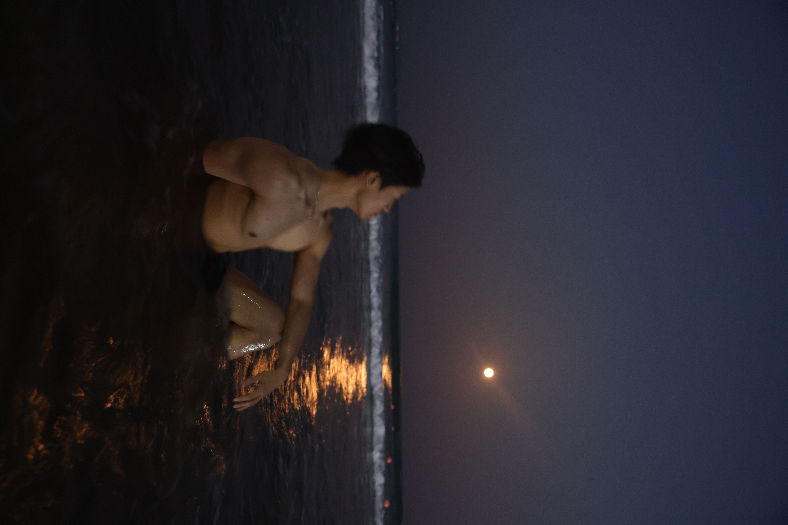

依稀记得我是为什么开始健身的，六年前的高二，那是一个170左右，100斤的瘦子，当时喜欢上了班上的一个女孩，高一结束的时候分科了，她选的是历史方向，我选的是物理方向，她在四楼，我在三楼，我和她并没有那么近，我和她的关系全靠我的哥们，也从哥们这里得知，目前她的班级有一个男生喜欢他，这个男生存在一些心理方面的问题，老是跟着她，她有些害怕，作为一个被喜欢冲昏头脑的人来说，我简直不允许这样的事情发生，从那时开始，晚上10点45熄灯之后在寝室床上开始了我的固定锻炼。

开始的目的仅仅是为了变强壮，胖揍那个男生一顿，保护我喜欢的女孩，现在想起来觉得自己好可爱，不过胖揍那个男生的愿望并没有实现，我没有在现实中主动对别人动过手。后面过了一段时间，我不记得是一个月还是两个月，我鼓起勇气向女生写情书，哈哈哈，非常Old school。不出意外的话，一切都在预料之中，我们从此没有了联系，但是，健身并没有停下来，反而成为了我第一件可以自己主动坚持做的事情。

没有闹钟，晚上我也不知道练到了几点，可能有半小时，练完之后睡觉，早上5点50起床准备早读，在这种情况下，我的精力居然变得更加充足，变得更有干劲了，我能明显的感受到自己身体和心理的变化，在高二的期中考试中，我的数学只考了64分（高中数学满分是150），在此之前，我对自己看法一直都是有点小聪明，每次考试都能在班上20名之前，我还洋洋得意。这次看着成绩单，好似雷击，不行，我应该没有那么笨，我不服气。

这是我第一次认认真真的学习，过了一两个月，我的数学单科考了好几次班上第二，果然，我还是没那么笨的，我开始想，既然经过我的努力单科可以名列前茅，那么我其他科目也认真学习岂不是，我的成绩也能突破班级前十名，在下学期中，平地一声雷，第一次月考总排名在班上第五，期中考试中更是得到上天眷顾（语文单选全对，考了124，物理平时30多分，这次破天荒的考了64），总分来到了559.5，这次不再是惊喜，我感受到的只有惶恐和压力。这个期间健身也并没有停止，那时候很疯狂，也没看什么科学锻炼指引，每天为什么雷打不动的在床上安静锻炼，我尽可能的不发出声音，避免影响室友，锻炼中也带着一丝丝的不甘，也就是那种现在你看不上我，后面我一定要变得更好，大暄哥的Dark Force理论还在发力，现在想想挺心疼当时的自己。

我始终坚信的认为是健身这件事情间接的影响了我的学习，以及我后面学习的态度，在最终的高考中以物理方向普通班第一的分数考入湖北工业大学计算机学院。

在大学期间，也是如此，晚上在宿舍里面锻炼，为什么不去健身房呢，一方面我觉得健身房里面人太多，用器材还要排队，耽误自己锻炼，我就买了一对哑铃，总共30kg，另一方面，健身房年卡也不便宜，大学的我并没有那么富裕，这笔钱也没必要花，我在宿舍同样练得很好。后面我意外的发现，在宿舍锻炼这种方式其实特别好，瑜伽垫一展开，直接开练，不会受到外面天气或者其他因素的阻碍，导致自己不想去健身房，因为做这件事的成本足够的低，启动足够的快，几乎没有什么理由不去做，除非是真的状态不佳需要休息。

随着时间的加长，对健身这件事也渐渐有了不同的感触，开始时的欣喜，张扬，身体的伤痛，中间对维持身材，想取得更大进步时的自我折磨和痛苦，到现在成为生活一部分的平淡和看到现在自己身材时那种发自内心对自己的认可，这六年的健身之路带给了我非常丰富的感受和成长，健身就像是一颗石子，丢在六年前自己的心灵湖水中，泛起了层层涟漪，悄无声息的改变了我生活的方方面面，也让我对自己的认识更多了一些。

去年夏天参加学校安排的生产实习，在青岛的金沙滩拍了几张照片，我非常喜欢。

这一路走来，从最初想要保护自己喜欢的人开始，到现在健身这件事对我的意义，我已经无法通过三言两语说清楚，过程也遇到了各种喜欢运动的伙伴，因为健身这件事结缘，健身已经成为我生命的一部分。

