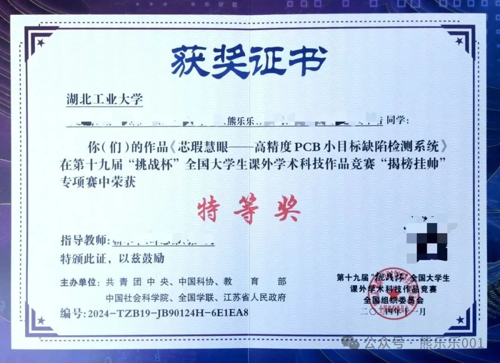
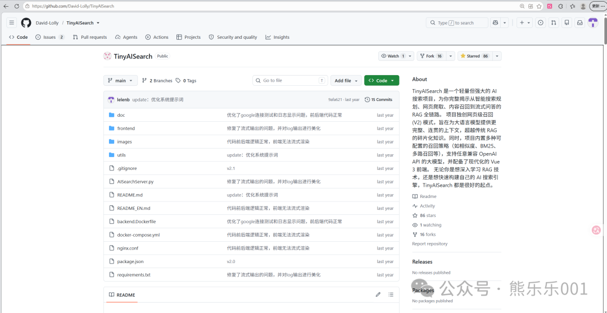
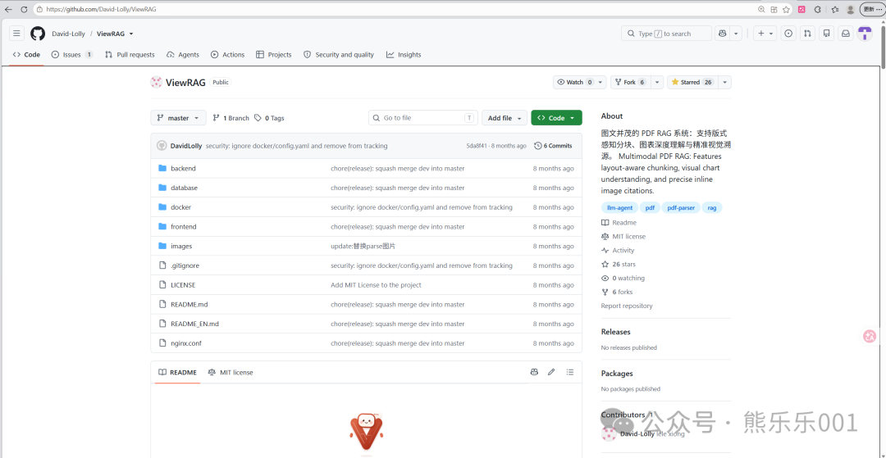

陈天奇在WhynotTV播客中说：我一直想着做某个领域，不断努力，后面遇到问题的时候就可以信手拈来，后来发现不是这样的，在做感兴趣的事情时总会有紧张，有挑战，甚至是更大的困难。那又怎么样呢，初生牛犊不怕虎，做就好了。

这句话对我产生了巨大的宽慰，我之前也是常常幻想着，当我把某个领域的核心知识都学了，不断努力达到熟练，后面在面对困难的时候自己就不会那么难堪的矗立在原地，不知所措，可以游刃有余的搞定一切。

这是一个美好的愿望，以至于我在大一、大二的时候一直处于准备中，我不敢去参加比赛，在大一下学期的专业分流中，我也不敢去报名AI创新班，这个专业是唯一需要经过绩点、笔试和面试筛选才能进入的，软件工程、计算机科学与技术和信息安全等则不需要，有那么多比我厉害的高手，凭什么我能进呢，我认为自己没有准备好，我也不相信自己准备好了。至于为什么最后进入了，那全是因为我的室友鼓励我和他一起报名，我才斗胆尝试。

大二的大部分时间也是在准备中，我知道我大概率选择毕业直接就业，我需要打比赛获得一些奖项证明，但是，我一直处于准备中，我不认为我做好了打比赛需要的知识储备。终于，在下学期还是等不下去了，没有多少时间留给我继续准备了。于是，开启了我大学的第一次比赛-信创大赛人工智能赛道，比赛是答题的形式，结果是拿了个银牌作为开端，我开始明白，我好像不需要准备到100%才可以去打比赛，更进一步来说就是，我随时都可以去做我想做的事情。

接下来就是疯狂的比赛，24年5月计算机设计大赛（省级二等奖）→24年8月智能制造赛（国家级二等奖）→24年11月挑战杯（国家级特等奖），一路走来几乎拿到了学科竞赛中最高的奖项，我并不能说我在里面发挥了什么举足轻重的作用，相反，更多靠的是团队。

从那以后，我就没再参加比赛了，转头去做更让我兴奋和激动的开源项目了。

经过这些之后，更加让我明白了，我真的不需要准备好才可以开始做某件事，因为，我根本不可能做好准备，在真正做某件事的过程中会发生很多意向不到的事情，和自己当初的设想相差非常远。

那么，我们在做任何事情的时候都不需要提前准备了吗？也不是，而是我们可以提前意识到，我并不需要准备到某个程度才可以做这件事，我随时都可以开始。

在自己没有做好准备的时候给自己更多的鼓励，尽早的去做想要做的事情，给自己更多的耐心和理解，让自己在碰撞的过程中不断向前，直到把事情做成，达到自己的目标。

教员在毛选第一卷中说到：<strong>读书是学习，使用也是学习，而且是更重要的学习。从战争学习战争——这是我们的主要方法。没有进学校机会的人，仍然可以学习战争，就是从战争中学习。革命战争是民众的事，常常不是先学好了再干，而是干起来再学习，干就是学习。</strong>

对于现在的我来说，我也常常失掉这个感悟，陷入完美准备的陷阱中，我需要不断提醒自己，让实践来给我反馈，告诉我还有哪些地方是欠缺的，实践的反馈是一个很好的信号，可以精准的暴露出当下的不足，知道自己有哪些不足，然后精准发力，去学习、再实践，直到自己可以解决这个问题。这和PDCA（Plan-Do-Check-Act）循环的核心思想不谋而合，<strong>先干起来，再通过反馈修正，然后越干越好，进入正向的循环。</strong>

我们不可能等到一切都准备好了再去做某件事，因为这一天可能永远都不会到来。反过来说就是，你现在已经准备好了，你已经可以开始去做了，并且你做成什么样，我都不会惊讶。

诸君，共勉。

---

原文发布于微信公众号：[我们不可能准备好再开始](https://mp.weixin.qq.com/s/4s4joCu-WqQlnuwVARrZgw)
