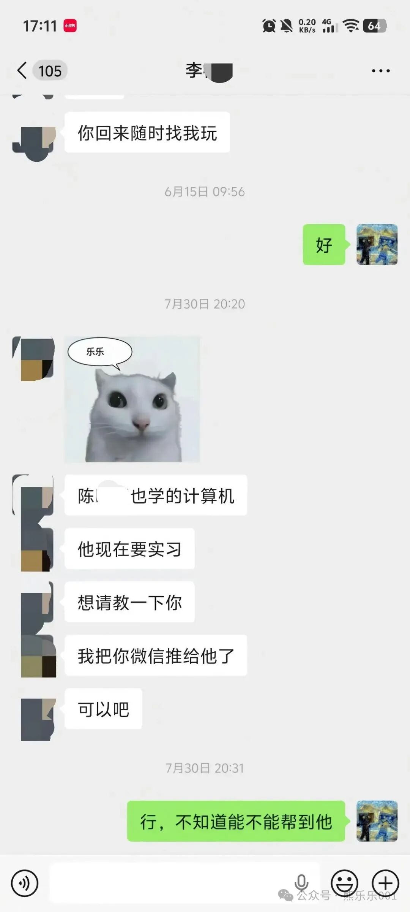
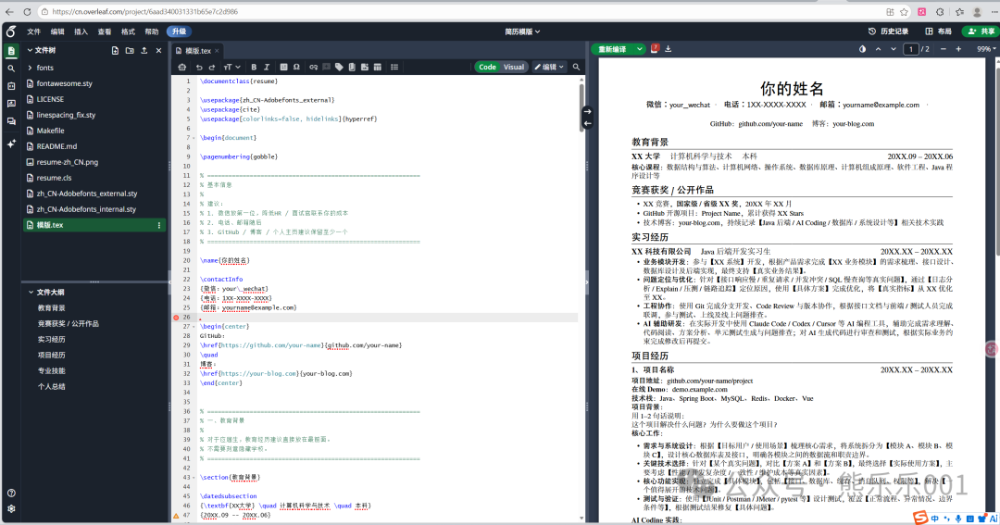

在我找工作的过程中，我的简历得到了不少来自老师、同学，甚至招聘者的认可，期间也有其他同学询问过我简历怎么写、用的什么模版，索性就把本次帮老同学改简历的过程和我对写简历这件事情的思考记录了下来，把陪伴我三次找工作经历的简历模板放在后面，并且附上使用教程，希望对现在或者未来找工作的同学有所帮助。本文很多内容是通用的，不仅仅是针对计算机专业的同学。

前段时间，朋友突然找到我，说我们高中的一个同学 学的也是计算机，他在找实习，想请教一下我，准备把我的微信推给他，我抱着试试看能不能帮到他的态度同意了。目前这位同学已经实习一个月，为他感到高兴。下面是当前的聊天内容。

回到故事开头，和朋友说完的第二天老同学找到了我，我们是高三时期的室友，他复读了一年，我们算不上关系有多好，他还是出于礼貌的聊了一些有的没的，我也能够感受到那种不好意思和扭捏，我就让他直说有哪些需要我帮忙的，不必寒暄，他想让我帮他看看简历，他走的是Java开发，现在这个时间段Java开发应该是相当的饱和，从形势来看应该是比较糟糕，加上现在AI Coding的快速发展，他的简历还是很危险的。

我看了一下他的简历，大致有下面四个需要修改的地方:

01

## 联系方式

顶部联系方式这里没有放自己的微信，微信几乎是大家最常用的联系方式，我建议简历顶部的联系方式中第一个就放微信，然后是电话和邮箱。这个小细节大家可以注意一下

02

## 基本信息

对于应届生来说，教育信息对企业来说是比较重要的，他放在了最后，专业技能放在了最上面，他是二本学校的，这个可以理解，但还是建议放在顶部，藏着掖着也没啥必要。我建议他和专业技能交换一个位置，教育经历这种基本信息放在首位。

03

## AI Coding实践

整个简历没有提到任何和AI Coding相关的能力介绍，这对于找第一份工作来说。在这个时代，不会用AI编程我认为基本宣判死刑，企业大概率不会要一个不会用AI的初级工程师，如果你的学历比较高，能力强，从事特定的编码或者关系很硬的当我没说。我知道作为一个学生是怎么考虑的，害怕企业认为自己使用AI做各种事情没有自己思考，就像是在学校考试作弊一样，不敢在简历体现，其实企业压根就不在意你是怎么做的，企业更关心的是你对所做事情的理解，对前沿情况的关注，说到这里，我想起来当时和我一样都是应届入职的毕业生，问我工作中能不能用AI，我承认，我之前也是这样，这种担忧就好像所有的事情我都必须隔绝世界，全靠自己的能力把事情搞定，这才能证明我是真的有能力，而不是通过查资料或者直接让AI来做这种“作弊手段”。

事实就是，工作中没人关心你是怎么搞定的，甚至你去请外界的人帮你搞定工作也行，只要你有那个本事。花了这么大篇幅说这个事情，就是希望找工作的同学可以意识到在后面真实的工作中不是什么事情都必须亲力亲为，而是你要能够理解你做的事情，用更好、更高效的方式完成工作，至于用什么方式，那就看你的本事了。工作中没人关心你是自己一行行手搓还是AI生成，甚至在这个时代，你手搓代码，企业反而怀疑你对新鲜事情的接受程度，从我身边来看，目前几乎没有工程师手搓代码，更多的是需要你理清楚业务逻辑，理清楚准备实现的需求。

在项目中可以适当展现如何使用AI进行需求分析，模块拆解，实现，测试验收的完整流程，如何进行的技术选型，考量是什么，要有自己的思考，展现自己对AI工具的理解和驾驭程度。

04

## 个人能力展示

个人项目就只有简单的描述，我建议直接将个人项目放在github，一方面更加可信，talk is cheap，show me the code（口说无凭，证据在哪？），第二就是让别人一看就知道你基本会使用git进行代码管理，这是软件工程师最基本的技能。

甚至这一点可以作为最重要的展开，尽可能的在公开场合展现你自己。找工作从世俗上面理解就是把你一天的八个小时以你比较满意的价格售卖出去，怎么让雇主更快的了解你、信任你，这是简历最需要展现的东西。

简历篇幅太有限，所以，我们需要知道简历之外重要的是什么，是让别人看见你，知道你在干什么、想什么，降低别人了解我们的难度，这就引出了我们要怎么对外展示自己，我认为写博客、做分享、做有用的开源项目就是最好的方式。别人在看到你的文章、你的项目的时候根本无需怀疑，因为你是直接公开展现出来的，他只需要通过看这些东西就能基本了解你的能力和你的基本底色。

大家不要以为企业招人只看能力，你的三观、对工作的态度等等这些技能之外的东西同样重要，这些东西也是简历三言两语无法说清楚。这件事不仅仅局限于找工作和实习，对于你个人的发展都是很有帮助的，这件事可以形成复利。

05

总结一下

一、简历中几个大模块的基本顺序，我个人的排序方式如下，这里仁者见仁智者见智：

## 1. 教育背景

## 2. 竞赛获奖/作品

## 3. 实习经历

## 4. 项目经历

## 5. 专业技能

## 6. 个人总结

二、降低别人了解你的门槛，试着公开你的思考。写写博客，试着做点有意思的项目，公开自己的代码，或者去给开源项目做贡献，让别人能直观的看到你做过的工作，更快的信任你。

三、体现自己对AI的驾驭程度，我认为这个可能对目前各行各业找工作都有用，毕竟AI干一些有标准流程的事情太容易了，这可以体现你对日常工作的观察、思考，让某些流程可以自动化的完成，帮助自己提效。企业的目的就是使用更低的成本实现更高效的生产嘛。

四、简历只是你所做事情的浓缩，正所谓台上一分钟，台下十年功。尽量不要在临近找工作的时候才想起来简历这件事，在平时的学习中就可以对这件事有所思考和准备，这是最理想的方式。

上面讲到的都是和道相关的，多用道，少用术。在找工作这件事上面，我认为还是可以用的，找工作是一件你短期拥有可以促进你长期拥有的事，当你找到了第一份工作，后面就会变得相对顺利。该吹牛的地方就吹，不足的地方大方承认，虚心学习。这里就不展开了，我相信大家都有属于自己的方式。

我把简历模板放在了下面的网盘中，并附上了使用文档，参考里面的文档说明就可以快速上手，只需要把里面的内容改成你的经历即可。

https://pan.baidu.com/s/1UVOhvss06sxTg9eNxTUF3g?pwd=xll1提取码: xll1

简历模板最初来自 https://github.com/hijiangtao/resume 项目，网络条件允许的情况下，请去给项目点个Star，这是对作者最好的认可！

如果再也见不到你，祝你实习顺利、工作顺利、生活顺利。

---

原文发布于微信公众号：[AI时代，简历应该怎么写](https://mp.weixin.qq.com/s/Z9y4DUkiLIfqfV2jvRcF5A)
